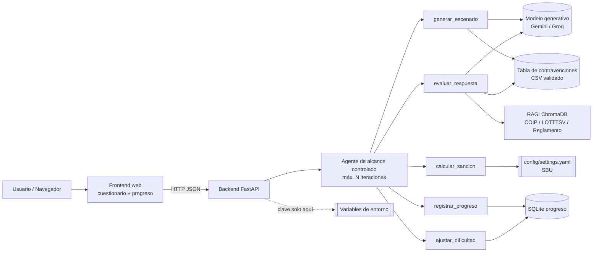

# 03 · Arquitectura

## Diagrama

## Flujo de una consulta
1. El usuario elige perfil y nivel; el frontend llama `POST /api/escenario`.
2. El agente ejecuta `ajustar_dificultad(historial)` y luego `generar_escenario(nivel, perfil)`.
3. `generar_escenario` selecciona 1–2 filas de la **tabla**, pide al modelo (few-shot, salida JSON) una situación y opciones, y **valida** que `contravencion_id` exista en la tabla. Si no, descarta y reintenta (máx. 2).
4. El frontend muestra situación y opciones. El usuario responde (`POST /api/respuesta`).
5. `evaluar_respuesta` compara la elección contra la respuesta correcta (determinista); recupera por RAG el fragmento del artículo; el modelo redacta la retroalimentación **solo con ese fragmento**; si no hay fragmento, se abstiene.
6. `calcular_sancion(porcentaje_sbu)` calcula la multa = % × SBU de configuración; puntos vienen de la tabla.
7. `registrar_progreso` guarda el resultado; se devuelve retroalimentación + sanción + cita.

## Herramientas del agente
| Herramienta | Tipo | Entrada | Salida | Config / notas |
|---|---|---|---|---|
| `generar_escenario(nivel, perfil)` | LLM + validación | nivel, perfil | situación, opciones, correcta, contravención | Prompt versionado en `prompts/`; descarta si no está en la tabla |
| `evaluar_respuesta(escenario, respuesta)` | Determinista + RAG + LLM | escenario, opción | acierto, explicación, cita | Rechaza respuestas fuera de opciones |
| `calcular_sancion(porcentaje_sbu)` | **Determinista** | % del SBU | multa en USD | SBU leído de `config/settings.yaml` |
| `registrar_progreso(usuario, resultado)` | Determinista | usuario anónimo, resultado | confirmación | SQLite; sin datos personales |
| `ajustar_dificultad(historial)` | Determinista | historial | nivel siguiente | Umbrales en configuración |

Reglas del agente: límite de iteraciones, rechazo de consultas fuera de dominio, negativa ante pedidos de evasión, confirmación del usuario antes de borrar su progreso.

## Qué va en configuración
SBU y año de vigencia, umbrales de dificultad, nivel de temperatura, modelo y límites de tokens, rutas de datos, nº de reintentos.

## Decisiones técnicas iniciales
| Decisión | Elección | Motivo |
|---|---|---|
| Backend | Python 3.11+ / FastAPI | Stack base del seminario |
| Esquemas | Pydantic | Validar entradas y salida del modelo |
| Vector DB | ChromaDB persistente | Gratuito, simple |
| Embeddings | sentence-transformers multilingüe (local) | Sin cuota |
| Progreso | SQLite | Sin servicio externo |
| Frontend | Streamlit **o** HTML/JS | Cuestionario con puntaje |
| Despliegue | Render / Railway / HF Spaces | Gratuito; `/health` + índice reconstruible al arranque |
