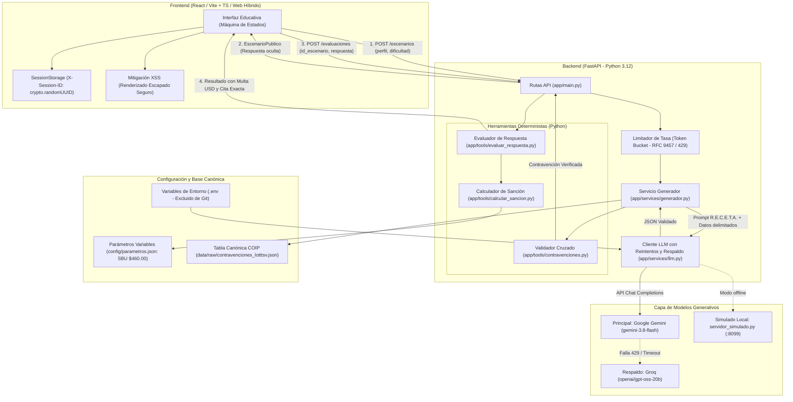

# 03 · Diseño de la Arquitectura: Simulador Vial «Vía Segura»
**Caso N.° 08 · Seminario de Titulación en IA Generativa · UNIANDES**

---

## 1. Diagrama de Arquitectura de la Solución (Mermaid)

---

## 2. Descripción del Flujo de una Consulta de Principio a Fin

El ciclo de interacción comprende dos fases desacopladas para garantizar el rigor pedagógico y evitar que el cliente conozca la respuesta antes de emitir su juicio:

### Fase A: Solicitud y Generación del Escenario
1. **Petición del Usuario:** El usuario selecciona en el frontend su perfil (`conductor_particular`, `conductor_profesional`, `peaton`) y nivel de dificultad (`baja`, `media`, `alta`), pudiendo especificar un tema opcional. Se despacha `POST /escenarios` con la cabecera `X-Session-ID`.
2. **Control de Flujo y Tasa:** `LimitadorTasa` verifica el balde de la sesión. Si no hay fichas, expide un código `429 Too Many Requests` con la cabecera estándar `Retry-After` (RFC 9457).
3. **Construcción Confinada del Prompt:** El servicio `generador.py` extrae las contravenciones aplicables desde `data/raw/contravenciones_lotttsv.json` y empaqueta la solicitud y las opciones candidatas en etiquetas XML `<solicitud>` y `<contravenciones_permitidas>`.
4. **Llamada Resiliente al LLM:** `ClienteLLM` invoca al modelo mediante modo JSON estructurado (`response_format` con `EscenarioVialSchema` y `extra="forbid"`). Ante errores 429 del proveedor o tiempos de espera agotados, aplica reintentos con retroceso exponencial y conmuta al proveedor de respaldo si persiste el fallo.
5. **Validación Determinista Cruzada:** Antes de enviar el escenario al frontend, `validar_escenario()` comprueba que el `id_contravencion_asociada` existe en la tabla canónica y aplica al perfil. Si el modelo inventó una contravención, el escenario se descarta automáticamente y se solicita una regeneración limpia.
6. **Emisión Pública:** El backend guarda el escenario en su registro temporal y devuelve al usuario el modelo `EscenarioPublico`, el cual expone la situación y las 4 opciones pero **omite intencionalmente** la respuesta correcta, la explicación y la sanción.

### Fase B: Evaluación y Retroalimentación Determinista
1. **Envío de Respuesta:** El usuario selecciona una opción (A, B, C o D) y envía `POST /evaluaciones`.
2. **Evaluación 100% Determinista (Sin LLM):** El backend recupera el escenario original asociado a la sesión, valida que no haya sido respondido previamente y ejecuta `evaluar_respuesta()`.
3. **Cálculo Matemático:** `calcular_sancion()` lee el Salario Básico Unificado vigente desde `config/parametros.json` (ej. $460.00 USD) y realiza el cálculo de la multa utilizando aritmética precisa con `Decimal`:
   $$\text{Multa (USD)} = \text{SBU} \times \left( \frac{\text{Porcentaje SBU}}{100} \right)$$
4. **Entrega de Retroalimentación:** El sistema entrega la respuesta correcta, la explicación educativa, la norma infringida con su artículo exacto y los puntos reducidos.

---

## 3. Principios de Seguridad y Robustez de la Arquitectura

1. **Defensa en Profundidad (OWASP LLM01 - Inyección):** Las entradas libres del usuario nunca se concatenan como órdenes; se transmiten como cadenas JSON dentro de etiquetas de datos.
2. **Protección contra Alucinaciones (OWASP LLM09):** El modelo propone únicamente el relato situacional y la redacción de opciones; la validez jurídica la certifica la tabla canónica y las multas las computa Python.
3. **Mitigación XSS (OWASP LLM05):** El frontend renderiza todo el contenido dinámico mediante enlaces de texto reactivos seguros de JSX (`{situacion}`), prescindiendo por completo de `dangerouslySetInnerHTML`.
4. **Cumplimiento LOPDP:** Esquema libre de datos personales. Las sesiones se identifican mediante UUIDv4 aleatorios en `sessionStorage` que expiran al cerrar la pestaña del navegador.
